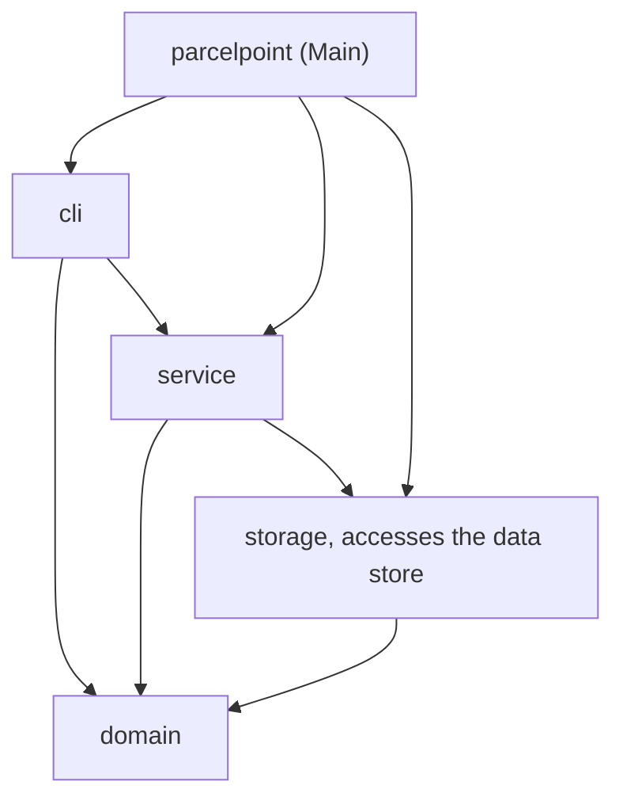
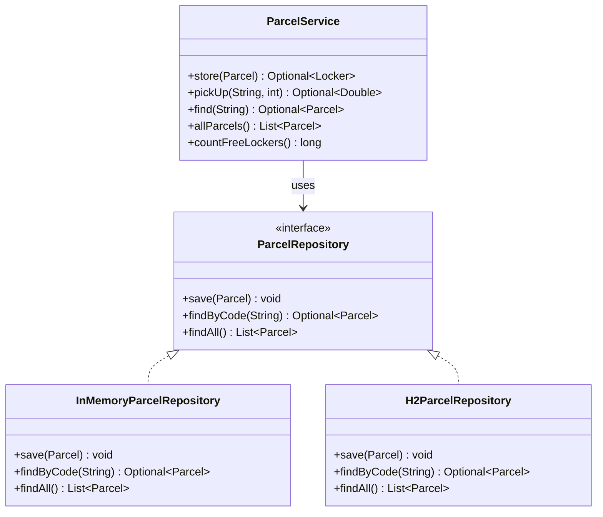
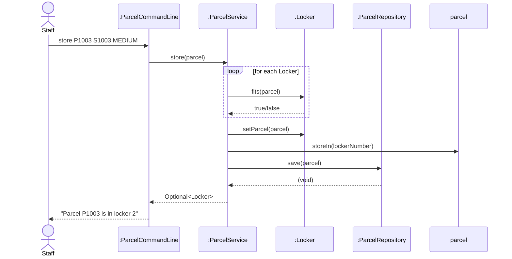

# Lab Report, Designing the Data Management Layer with H2

Repository URL: https://github.com/Nuttanun12/ITCS382_Lab_H2_Data_Store

## Tools

| Item | Version or name |
| --- | --- |
| JDK | OpenJDK 25.0.2 (Temurin-25.0.2+10) |
| Maven | Apache Maven 3.10.0 |
| IDE | Visual Studio Code |
| AI tool and exact model, if you used one | Antigravity (Claude Sonnet 4.6 Thinking) |

## Part 0. From a store in memory to H2

Commit of the starter, before any change: `3819b28`

0.3 Your prediction for `staff`, written before the second run:

The second run will show no parcels — only `Free lockers: 3` — because the program stores parcels in memory (a Java `LinkedHashMap`) and that memory is freed when the program exits. The two parcels stored in the first run no longer exist.

Output of the second run, for `staff` and `quit`:

```text
> staff
Free lockers: 3
> quit
```

State in one sentence where you think the parcels of the first run were kept.

The parcels were kept in the heap memory of the JVM process, inside the `LinkedHashMap` field of `InMemoryParcelRepository`, and vanished the moment the process ended.

0.5 The line of Main that you would change to keep the parcels somewhere else:

```java
ParcelRepository repository = new InMemoryParcelRepository();
```

0.6 Commit of the switch to H2: `c7a533a` `ce85787`

0.7 Output of `SELECT * FROM PARCEL;` after you stored two parcels:

```text
sql> SELECT * FROM PARCEL;
CODE  | STUDENT_ID | PARCEL_SIZE | STATUS | LOCKER_NUMBER
P1001 | S1001      | SMALL       | STORED | 1
P1002 | S1002      | LARGE       | STORED | 3
(2 rows, 6 ms)
```

0.8 Explain why ParcelPoint could not start while the H2 Shell was open, and identify the class that wrote the message `Cannot create the PARCEL table`.

H2 is an embedded database that belongs to the one process that opened it. When the H2 Shell holds the database open, H2 locks the file `parcelpoint.mv.db`, so a second program cannot open the same file at the same time. The class `H2ParcelRepository` wrote the message `Cannot create the PARCEL table` — it catches the resulting `SQLException` in its constructor and wraps it in an `IllegalStateException` with that message.

0.9 Explain why `staff` shows no parcel while `find` shows each one, and why all three lockers look free.

`find` calls `findByCode`, which is fully implemented and queries the PARCEL table by code. `staff` calls `findAll`, which at this point still returns an empty list (`List.of()`) because the TODO body was not yet written. Because the constructor of `ParcelService` calls `findAll` to reload waiting parcels into the in-memory `Locker` objects, it gets an empty list, so none of the lockers are restored — that is why `countFreeLockers()` counts all three as free.

0.11 Your findAll method:

```java
@Override
public List<Parcel> findAll() {
    String sql = "SELECT * FROM PARCEL ORDER BY CODE";
    List<Parcel> parcels = new ArrayList<>();
    try (Connection connection = connect();
         PreparedStatement statement = connection.prepareStatement(sql);
         ResultSet row = statement.executeQuery()) {
        while (row.next()) {
            parcels.add(toParcel(row));
        }
    } catch (SQLException e) {
        throw new IllegalStateException("Cannot read the parcels", e);
    }
    return parcels;
}
```

Commit that adds findAll: `f2d0003`

0.12 Output of `SELECT * FROM PARCEL;` after the pickup:

```text
sql> SELECT * FROM PARCEL;
CODE  | STUDENT_ID | PARCEL_SIZE | STATUS    | LOCKER_NUMBER
P1001 | S1001      | SMALL       | PICKED_UP | null
P1002 | S1002      | LARGE       | STORED    | 3
(2 rows, 5 ms)
```

0.13 Optional. Describe what `find P9999'OR'1'='1` showed while the SQL was joined from strings, and what it showed after you put the placeholder back.

While the SQL was built by string concatenation, `find P9999'OR'1'='1` returned the first row in the table (P1001's record), because the injected condition `'1'='1'` is always true and made the query match every row. After restoring the `?` placeholder and `setString`, the same input returned "No parcel with code P9999'OR'1'='1" — H2 compared CODE with the full literal string the user typed, so no row matched.

## Part A. Model the design

A1 Complete the flowchart with one node for each package and one arrow for each dependency, from the package that uses to the package that is used. Mark the package that accesses the data store.



State whether cli depends on storage, and explain why.

`cli` does **not** depend on `storage`. `ParcelCommandLine` imports only from `parcelpoint.domain` and `parcelpoint.service`; it never names any class in `parcelpoint.storage`. All repository access goes through `ParcelService`, which holds the `ParcelRepository` reference, so the command-line layer is fully decoupled from the data store.

A2 Complete the class diagram of the data management layer with ParcelService, the interface ParcelRepository with its three operations, and the two classes that implement it.



A3 Draw a sequence diagram for the command `store P1003 S1003 MEDIUM`, from the staff member to the repository. Show each message as an operation of the class that receives it.



Explain why the last lifeline is the interface ParcelRepository rather than H2ParcelRepository.

The sequence diagram ends at the interface `ParcelRepository` because `ParcelService` only knows about the interface — it declares its field as `ParcelRepository`, not `H2ParcelRepository`. The code of `ParcelService` never names a concrete repository class; `Main` decides which implementation stands behind the interface. The sequence diagram shows the design as the program's business layer sees it, not the hidden implementation detail.

## Part B. Design questions

1. Identify the files that you changed to move from the store in memory to H2, and explain why no other class had to change. Use the terms of this course.

Only `Main.java` had to change (one import and one line in `main`). No other class changed because `ParcelService`, `ParcelCommandLine`, and all domain classes depend only on the `ParcelRepository` **interface**, not on any concrete class. This follows the **Dependency Inversion Principle**: high-level modules (`ParcelService`) depend on an abstraction, and `Main` is the single place that selects the concrete implementation. Swapping `InMemoryParcelRepository` for `H2ParcelRepository` required changing only the one class that creates the repository object.

2. The PARCEL table stores the size of a parcel as SMALL, MEDIUM or LARGE rather than as 1, 2 or 3. Identify the type of connascence between ParcelSize and the table in each case, and explain which one is weaker.

Storing the name (SMALL, MEDIUM, LARGE) creates **connascence of name**: both sides must agree on the same string name, and `ParcelSize.valueOf` turns the stored text directly back into the enum constant. Storing a number (1, 2, 3) would create **connascence of position**: both sides must agree on which integer maps to which size, an implicit contract that cannot be read from the value alone. Connascence of name is weaker — a name carries its own meaning, so a mismatch is immediately visible and the mapping has no hidden order dependency.

3. Project Phase 2 asks for a data store that needs no separate server. Explain why an embedded database such as H2 meets this rule, and describe the limit of an embedded database that Step 0.8 showed.

H2 is a pure-Java library that runs inside the program's own JVM process. It stores its data in a local file (`parcelpoint.mv.db`) and needs no installation, background service, or network port of its own, so it satisfies the "no separate server" rule automatically. The limit that Step 0.8 showed is that an embedded database can be held open by only **one process at a time**: while the H2 Shell had the file locked, a second run of ParcelPoint failed immediately. This means the application and any external inspection tool cannot access the same embedded database simultaneously.

4. State the data store that you would choose for your Project Phase 2 team, files or an embedded database, the requirement that drives the choice, and the package that will access it.

I would choose an **embedded H2 database**. The requirement that drives the choice is the need to query and filter records efficiently (for example, finding parcels by student ID or status) without loading every record into memory, which a flat file would require. H2 supports SQL, creates its schema automatically on the first run, and needs no separate server, satisfying all Phase 2 constraints. The package that will access it is the **storage** package, through a repository interface identical in structure to `ParcelRepository`.

## AI usage declaration

| AI tool and exact model | Date | Purpose | Files or answers it produced or changed | How you checked its output |
| --- | --- | --- | --- | --- |
| Antigravity – Claude Sonnet 4.6 Thinking | 2026-11-14 | Read the PDF, executed lab steps (build, run, H2 Shell queries), wrote `findAll()`, completed diagrams and Part B answers | `Main.java`, `H2ParcelRepository.java`, `LAB_REPORT.md` | Ran `mvn package` and verified BUILD SUCCESS; ran the program interactively and confirmed staff output matched expected results; ran H2 Shell queries and compared output with lab expectations; reviewed all diagram arrows against import statements in the source files |
